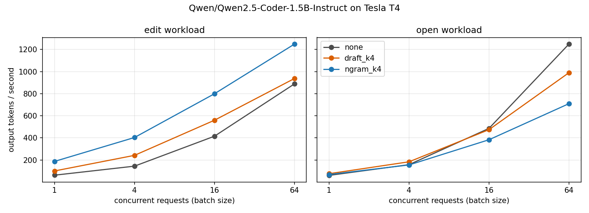

# inference-bench

When does speculative decoding actually speed up LLM serving?

This benchmarks [vLLM](https://github.com/vllm-project/vllm) on two kinds of request:

- **edit**: add type hints to a real Python stdlib function. Most of the answer copies the prompt, like a coding agent applying a small change.
- **open**: write a 250-word explanation. The answer shares little text with the prompt.

It compares three engine configs across batch sizes 1, 4, 16 and 64:

| config | how it guesses tokens |
|---|---|
| `none` | no speculation (baseline) |
| `ngram_k4` | prompt lookup: finds the last few tokens earlier in the prompt and proposes what followed them |
| `draft_k4` | a 0.5B draft model proposes 4 tokens, and the 1.5B target model verifies them in one forward pass |

Decoding is greedy, so speculative decoding should produce exactly the baseline's text. `report.py` checks that for every prompt.

[](https://colab.research.google.com/github/Shri2007/inference-bench/blob/main/colab.ipynb)

## Hypothesis

- N-gram speculation should help most on **edit** at **small batch sizes**. The output repeats the prompt, so guesses are often right, and a single request leaves the GPU memory-bound with spare compute for verifying guesses.
- The gain should shrink or go negative as batch size grows. Batching already uses that spare compute, and rejected guesses become wasted work.
- On **open**, n-gram guesses are rarely right, so expect little to no gain.

## Results

Model: `Qwen/Qwen2.5-Coder-1.5B-Instruct` on **Tesla T4**, vLLM 0.34.0, greedy, max 512 tokens.

| workload | batch | config | tok/s | speedup | acceptance | same text as baseline |
|---|---|---|---|---|---|---|
| edit | 1 | none | 63 | 1.00x | - | - |
| edit | 1 | draft_k4 | 101 | 1.61x | 95% | 100% |
| edit | 1 | ngram_k4 | 187 | 2.99x | 57% | 100% |
| edit | 4 | none | 144 | 1.00x | - | - |
| edit | 4 | draft_k4 | 242 | 1.68x | 95% | 100% |
| edit | 4 | ngram_k4 | 403 | 2.80x | 57% | 100% |
| edit | 16 | none | 415 | 1.00x | - | - |
| edit | 16 | draft_k4 | 560 | 1.35x | 95% | 100% |
| edit | 16 | ngram_k4 | 799 | 1.93x | 54% | 100% |
| edit | 64 | none | 888 | 1.00x | - | - |
| edit | 64 | draft_k4 | 937 | 1.05x | 94% | 100% |
| edit | 64 | ngram_k4 | 1248 | 1.41x | 53% | 100% |
| open | 1 | none | 61 | 1.00x | - | - |
| open | 1 | draft_k4 | 76 | 1.25x | 53% | 81% |
| open | 1 | ngram_k4 | 69 | 1.13x | 2% | 81% |
| open | 4 | none | 158 | 1.00x | - | - |
| open | 4 | draft_k4 | 184 | 1.16x | 54% | 94% |
| open | 4 | ngram_k4 | 155 | 0.98x | 3% | 94% |
| open | 16 | none | 486 | 1.00x | - | - |
| open | 16 | draft_k4 | 474 | 0.98x | 54% | 91% |
| open | 16 | ngram_k4 | 383 | 0.79x | 3% | 91% |
| open | 64 | none | 1249 | 1.00x | - | - |
| open | 64 | draft_k4 | 990 | 0.79x | 55% | 92% |
| open | 64 | ngram_k4 | 710 | 0.57x | 3% | 80% |




### Does speculative decoding change the output?

With greedy decoding it shouldn't. [`check_match.py`](check_match.py) compares every output to the baseline ([full output](results/match_check.txt)).

- **Control:** the baseline at batch 1 and batch 4 (the same 16 prompts) produced identical text on both workloads, 16/16 each. Batch size alone didn't change the output here.
- **Edit workload:** both speculative configs matched the baseline on every prompt at every batch size.
- **Open workload:** some outputs diverged, 3 of 16 at batch 1 for example.
- **N-gram and the draft model diverged on the same prompts at the same character** at batch 1 (chars 445, 887 and 502) and at batch 4 (char 241). Their guesses come from completely different sources, so the divergence isn't caused by the guesses. The most likely cause is the target model verifying several tokens in one forward pass, which gives slightly different fp16 logits than decoding one token at a time.
- The splits happen where two continuations are both reasonable. For example, the baseline wrote "such as web servers or **background services**" and the speculative run wrote "such as web servers or **desktop applications**".

So speculative decoding here is lossless up to floating-point precision, not bit-exact. That only shows up when the model is close to a tie, which is common in open-ended text and rare when copying code.

## What I learned

_Fill in after looking at the numbers. For each config: did it match the hypothesis, what was the acceptance rate, and where did the speedup disappear?_

## Run it

On a GPU machine (Colab T4 works):

```bash
pip install -r requirements.txt
python bench.py --spec none
python bench.py --spec ngram --k 4
python bench.py --spec draft --k 4
python report.py
```

Each config runs in its own process because vLLM does not reliably free GPU memory between engines. Results are saved after every run in `results/<config>.json`, along with the GPU, vLLM version and all generated text.

Notes:
- `--model` and `--draft-model` swap models. Defaults are `Qwen/Qwen2.5-Coder-1.5B-Instruct` and `Qwen/Qwen2.5-Coder-0.5B-Instruct`, which share a tokenizer.
- Everything runs in fp16 because the T4 has no bf16 support.
- Edit prompts come from the local Python's stdlib, so a different Python version gives slightly different prompts. The Python version is recorded in each results file.
