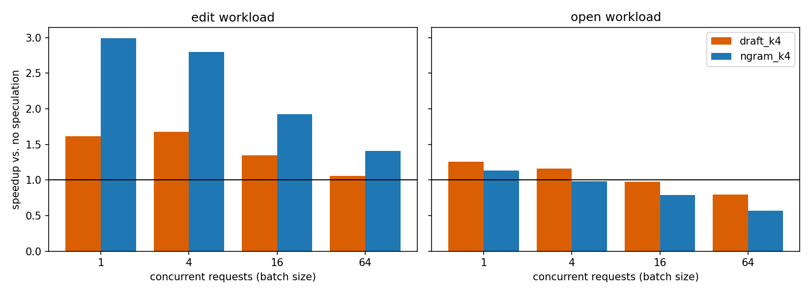

# inference-bench

When does speculative decoding actually speed up LLM serving?

This benchmarks [vLLM](https://github.com/vllm-project/vllm) on two kinds of request:

- **edit**: add type hints to a real Python stdlib function. Most of the answer copies the prompt, like a coding agent applying a small change.
- **open**: write a 250-word explanation. The answer shares little text with the prompt.

It compares three engine configs across batch sizes 1, 4, 16 and 64:

| config | how it guesses tokens |
|---|---|
| `none` | no speculation (baseline) |
| `ngram_k4` | prompt lookup: finds the last few tokens earlier in the prompt and proposes what followed them |
| `draft_k4` | a 0.5B draft model proposes 4 tokens, and the 1.5B target model verifies them in one forward pass |

Decoding is greedy, so speculative decoding should produce exactly the baseline's text. `report.py` checks that for every prompt.

[](https://colab.research.google.com/github/Shri2007/inference-bench/blob/main/colab.ipynb)

## Hypothesis

- N-gram speculation should help most on **edit** at **small batch sizes**. The output repeats the prompt, so guesses are often right, and a single request leaves the GPU memory-bound with spare compute for verifying guesses.
- The gain should shrink or go negative as batch size grows. Batching already uses that spare compute, and rejected guesses become wasted work.
- On **open**, n-gram guesses are rarely right, so expect little to no gain.

## Results

_Not run yet. After the Colab run, paste `results/summary.md` here and add the two charts._

<!--  -->
<!--  -->

## What I learned

_Fill in after looking at the numbers. For each config: did it match the hypothesis, what was the acceptance rate, and where did the speedup disappear?_

## Run it

On a GPU machine (Colab T4 works):

```bash
pip install -r requirements.txt
python bench.py --spec none
python bench.py --spec ngram --k 4
python bench.py --spec draft --k 4
python report.py
```

Each config runs in its own process because vLLM does not reliably free GPU memory between engines. Results are saved after every run in `results/<config>.json`, along with the GPU, vLLM version and all generated text.

Notes:
- `--model` and `--draft-model` swap models. Defaults are `Qwen/Qwen2.5-Coder-1.5B-Instruct` and `Qwen/Qwen2.5-Coder-0.5B-Instruct`, which share a tokenizer.
- Everything runs in fp16 because the T4 has no bf16 support.
- Edit prompts come from the local Python's stdlib, so a different Python version gives slightly different prompts. The Python version is recorded in each results file.
